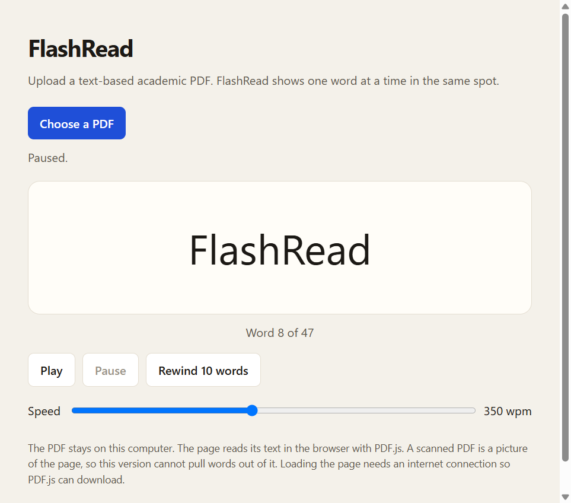

# FlashRead

> **One-line pitch:** FlashRead helps university students read academic PDFs more efficiently through Rapid Serial Visual Presentation (RSVP), showing one word at a time at an adjustable speed.

- **Builder:** John Fennell (`@jf5547`)
- **Pod:** Pod 4
- **Product Page & Living PRD:** https://building-with-ai-f26.github.io/jf5547-flashread/ (live once GitHub Pages is deployed from `main` → `/docs`)
- **App:** runs locally through Week 4; add a cloud URL in Build 5.

## What FlashRead does (Build 1)

Upload a text-based PDF and FlashRead extracts its text in your browser, then shows it one word at a time in a fixed spot. You can **Play**, **Pause**, **Rewind 10 words**, and set the speed from **150 to 600 words per minute**. The PDF never leaves your computer. There is no AI model and no API key.



**Limitations:** scanned PDFs (images of text) produce no words. Multi-column papers may extract in a messy order. Loading the page needs internet for PDF.js. Your place is not saved when you close the tab.

## Run FlashRead on Windows

**Dependencies:** none to install. The app uses [PDF.js 3.11.174](https://mozilla.github.io/pdf.js/), loaded from the cdnjs CDN, and Windows PowerShell, which is built into Windows, to serve the page locally.

1. Open the project folder in Cursor, then open a terminal: **Terminal → New Terminal**.
2. Run:
   ```powershell
   powershell -ExecutionPolicy Bypass -File app\serve.ps1
   ```
3. Your browser opens `http://localhost:8000`. If it doesn't, open that address yourself.
4. Click **Choose a PDF**, pick a text-based PDF, then press **Play**.
5. When finished, click in the terminal and press **Ctrl+C** to stop the server.

If you see "Only one usage of each socket address", FlashRead is already running in another terminal. Use that one, or stop it with Ctrl+C first.

## Start here: Build 1

**Due Monday, November 9 at noon, New York time.** No class November 3; keep building that week.

1. Join the [class organization](https://github.com/building-with-ai-f26), then use this template to create a **public** repo named `<netid>-<project-slug>`. Ask Christian or Hew if the organization is missing from the owner list.
2. Set up Git and one coding agent during the week of October 27. Follow the [Icerynk setup guide](https://www.icerynk.com/c/fa26-tech-gb-2160-dm2-f2/content/pre-class-setup-github-openrouter-your-coding-agent).
3. Publish [`docs/index.html`](./docs/index.html): **Settings → Pages → Deploy from a branch → main → /docs → Save**. When deployment finishes, open `https://building-with-ai-f26.github.io/<your-repo-name>/`.
4. Fill in PRD v1: a reachable user, their painful before/after workflow, one core workflow, and three non-goals.
5. Build a rough local prototype. Add a screenshot or GIF and an honest Build 1 log to the Product Page, including progress, learning, problems, costs, and hours.
6. Push meaningful commits on **at least two separate days each week outside class**, including the November 3 break.
7. Submit your **Product Page URL and repository URL in Icerynk**. Come ready to demo the prototype in two minutes on November 10.

Create your PostHog account in Week 1. Install it on the Product Page and local app in **Build 2**, then verify events. The Product Page is public from Build 1; the app can stay local through Week 4.

## Repository map

| File / folder | Purpose |
| --- | --- |
| [`docs/index.html`](./docs/index.html) | Required public pitch, living PRD, and weekly build log. Update with actual work and evidence. |
| [`Intent.md`](./Intent.md), [`Plan.md`](./Plan.md), [`journal/`](./journal/) | Optional drafting aids. No duplicate submission is required. |
| [`AGENTS.md`](./AGENTS.md) | Local run commands, project context, and agent rules. Build 2 onward. |
| [`tests/`](./tests/) | Verification guidance. Build 4 offers Track A domain evals **or** Track B user replays. |
| [`SPONSOR_MEMO.md`](./SPONSOR_MEMO.md) | One-page recommendation backed by actual usage, full costs, and risks. Due December 14 at noon. |

[Icerynk](https://www.icerynk.com/c/fa26-tech-gb-2160-dm2-f2/content) holds the assignment instructions and submissions.

## Local setup

Clone **your own repository** and ask your coding agent to document the exact install and run commands here and in `AGENTS.md`.

```bash
git clone https://github.com/building-with-ai-f26/jf5547-flashread.git
cd jf5547-flashread
```

If your app needs API keys, use a local environment file such as `.env`. Keep private keys out of source code, browser code, screenshots, and commits. The template ignores `.env`; `.env.example` contains placeholders only.
